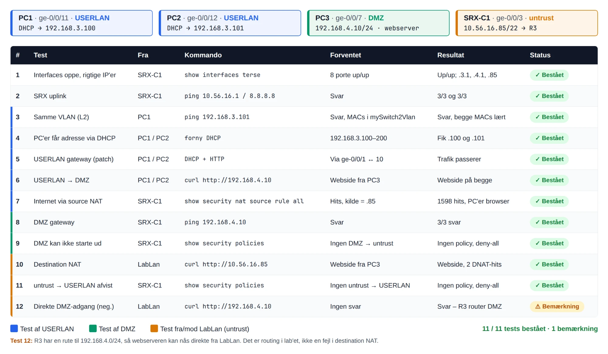

# Testplan – Assignment 34 (SRX L2 Switch, SOHO & Destination NAT)

Udført på R2 / SRX-C1 (SRX240) med PC1 og PC2 på USERLAN, PC3 som webserver i DMZ og en Linux-klient på LabLan. Enheder og adresser som i [README](README.md).

| Enhed | Port | Zone / VLAN | Adresse |
|---|---|---|---|
| PC1 | ge-0/0/11 | USERLAN (mySwitch2Vlan, 3) | 192.168.3.100/24, DHCP |
| PC2 | ge-0/0/12 | USERLAN (mySwitch2Vlan, 3) | 192.168.3.101/24, DHCP |
| PC3 / myWebServer | ge-0/0/7 | DMZ (mySwitch1Vlan, 4) | 192.168.4.10/24, statisk |
| SRX-C1 uplink | ge-0/0/3 | untrust | 10.56.16.85/22 → R3 (10.56.16.1) |

Gateways: USERLAN 192.168.3.1 (ge-0/0/1 ↔ ge-0/0/10), DMZ 192.168.4.1 (ge-0/0/2 ↔ ge-0/0/6).



## Tests

| # | Test | Fra | Kommando | Forventet | Resultat | Status |
|---|---|---|---|---|---|---|
| 1 | Interfaces oppe, rigtige IP'er | SRX-C1 | `show interfaces terse` | 8 porte up/up | Up/up; .3.1, .4.1, .85 | Bestået |
| 2 | SRX uplink | SRX-C1 | `ping 10.56.16.1` / `ping 8.8.8.8` | Svar | 3/3 og 3/3 | Bestået |
| 3 | Samme VLAN (L2) | PC1 | `ping 192.168.3.101` | Svar, MACs i mySwitch2Vlan | Svar, begge MACs lært | Bestået |
| 4 | PC'er får adresse via DHCP | PC1 / PC2 | Forny DHCP | 192.168.3.100–200 | Fik .100 og .101 | Bestået |
| 5 | USERLAN gateway (patch) | PC1 / PC2 | DHCP + HTTP | Via ge-0/0/1 ↔ ge-0/0/10 | Trafik passerer | Bestået |
| 6 | USERLAN → DMZ | PC1 / PC2 | `curl http://192.168.4.10` | Webside fra PC3 | Webside på begge | Bestået |
| 7 | Internet via source NAT | SRX-C1 | `show security nat source rule all` | Hits, kilde = .85 | 1598 hits, PC'er browser | Bestået |
| 8 | DMZ gateway | SRX-C1 | `ping 192.168.4.10` | Svar | 3/3 svar | Bestået |
| 9 | DMZ kan ikke starte ud | SRX-C1 | `show security policies` | Ingen DMZ → untrust | Ingen policy, deny-all | Bestået |
| 10 | Destination NAT | LabLan | `curl http://10.56.16.85` | Webside fra PC3 | Webside, 2 DNAT-hits | Bestået |
| 11 | untrust → USERLAN afvist | SRX-C1 | `show security policies` | Ingen untrust → USERLAN | Ingen policy, deny-all | Bestået |
| 12 | Direkte DMZ-adgang (neg.) | LabLan | `curl http://192.168.4.10` | Ingen svar | Svar – R3 router DMZ | Bemærkning |

## Destination NAT

Klienten på LabLan åbner `http://10.56.16.85` og får websiden fra PC3. På SRX-C1 bekræftes oversættelsen med:

```
show security nat destination rule all
show security flow session destination-prefix 192.168.4.10
```

Reglen `to-web` viser translation hits, og sessionen viser **In:** dst 10.56.16.85/80 og **Out:** dst 192.168.4.10/80.

## Konklusion

11/11 tests bestået. PC1 og PC2 får adresse via DHCP, kan nå hinanden på L2 og når både webserveren i DMZ og internettet via source NAT bag 10.56.16.85. LabLan når webserveren gennem destination NAT på 10.56.16.85:80, mens DMZ ikke kan starte forbindelser ud, og untrust ikke har adgang til USERLAN.

**Bemærkning til test 12:** R3 har en rute til 192.168.4.0/24, så webserveren kan også nås direkte fra LabLan. Det er routing i lab'et, ikke en fejl i destination NAT.
